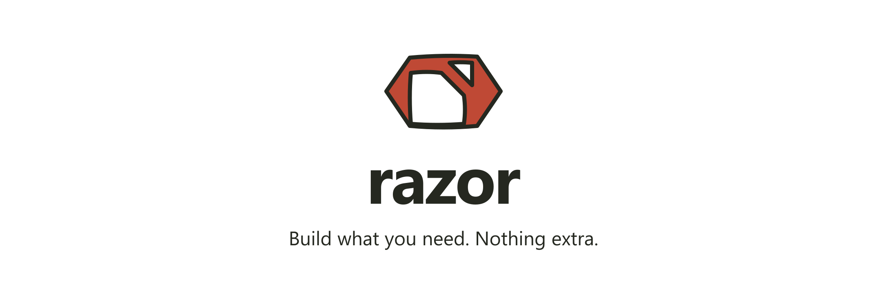
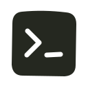
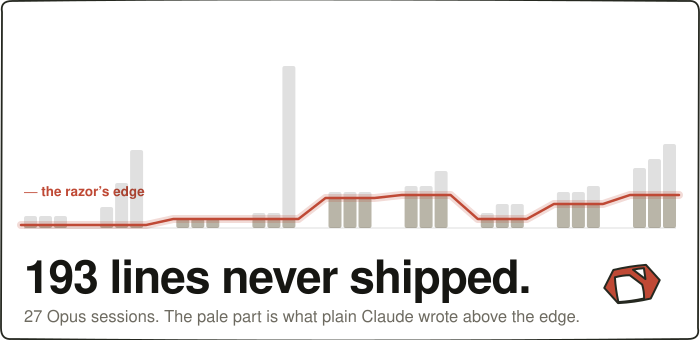

<div align="center">
  <picture>
    <source media="(prefers-color-scheme: dark)" srcset="assets/banner-dark.png" />
    
  </picture>
  <h1>razor</h1>
  <p><strong>Before adding code, ask whether the project already has what it needs.</strong></p>
</div>

<p align="center"><strong>Available on</strong></p>
<p align="center">
  <a href="#codex"></a>&emsp;&emsp;<a href="#claude-code"></a>&emsp;&emsp;<a href="#antigravity"></a><br />
  <a href="#codex">Codex</a>&emsp;&emsp;&emsp;&emsp;<a href="#claude-code">Claude</a>&emsp;&emsp;&emsp;<a href="#antigravity">Antigravity</a>
</p>

<p align="center"><a href="#install"><strong>Get started</strong></a> · <a href="#what-is-this">What is this?</a> · <a href="#how-it-works">How it works</a> · <a href="#what-you-can-do">What you can do</a> · <a href="#the-numbers">Evidence</a></p>

## What is this?

You ask for a small query parser. The assistant reaches for a package, adds helper files, and leaves you more code to maintain. Razor asks whether the language or your project already has what the task needs.

It puts a short checklist before new code and uses targeted checks to prompt reconsideration of unnecessary additions. The aim is to finish the requested work with less to maintain. This example illustrates the workflow; the measurements below describe specific recorded runs.

<p align="center"></p>

## Why you'd want it

- Reuse what the project already has.
- Reconsider unnecessary dependencies before installing them.
- Notice file growth before a small task becomes a larger project.
- Find declared dependencies that no source file appears to use.

## How it works

A checklist asks whether the work is needed, already implemented or covered by the language. Targeted checks can request one reconsideration. A retry follows the host’s normal permissions. The unused-dependency audit reports findings without uninstalling anything.

## What you can do

| You want to | Outcome |
| --- | --- |
| Keep a small task small | Check reuse, dependencies and file growth |
| Pause or resume the checks | Change the session toggle |
| Find unused dependencies | Receive a report with confirmed, likely and unknown findings |

Send `razor off` or `razor on` to pause or resume the checks for the session; `/razor off` and `/razor on` also work in Claude Code. Antigravity has no prompt event, so the toggle does not exist there; start it with `RAZOR_DISABLE=1` set to keep razor out of a session. For a dependency report, use `/razor:unused` in Claude Code, `$unused` in Codex, or `/unused` in Antigravity.

## Install

razor is one package for Claude Code, Codex and Antigravity. Install it in the one you use.

### Codex

Requirements: Node.js 22 or later, Git and a Codex host with plugin support.

```text
codex plugin marketplace add V-Songbird/foundry
codex plugin add razor@foundry
```

Review and enable its hooks, then start a new Codex session.

### Claude Code

Requirements: Node.js 22 or later, Git and Claude Code 2.1.139 or later.

Inside Claude Code:

```text
/plugin marketplace add V-Songbird/foundry
/plugin install razor@foundry
```

Start a new session to load the plugin.

### Antigravity

Requirements: Node.js 22 or later, Git and the Antigravity CLI. Antigravity has no marketplace for third-party plugins, so install razor from a clone of Foundry, which checks razor out at the commit the Claude Code and Codex catalogs pin. Replace `<path-to-clone>` with the directory to clone into:

```shell
git clone --recurse-submodules https://github.com/V-Songbird/foundry.git <path-to-clone>
agy plugin install <path-to-clone>/razor
agy plugin list
```

The list should name `razor`. Start a new conversation to load it. The checklist arrives at the first model call, the drift note at the first call of each turn, and the build check speaks through the stop hook. Antigravity has no subagent event, so subagents there receive no checklist.

The install is a copy, so it stays at that commit. To take a new release, update the clone, install again and start a new conversation:

```shell
git -C <path-to-clone> pull
git -C <path-to-clone> submodule update --init
agy plugin install <path-to-clone>/razor
```

## Good to know

Input validation, security and error handling that protects your work remain necessary. Explicitly requested scope stays yours to choose. These checks are advisory, not a security boundary.

File checks see the edits made through the assistant's own editing tool: `apply_patch` in Codex, `Write` and `Edit` in Claude Code, `write_to_file`, `replace_file_content` and `multi_replace_file_content` in Antigravity. Files written by a shell command skip them, and so do unsupported or ambiguous patches in Codex. See [setup and coverage](docs/knowledge/codex-setup.md) and [how razor works](docs/knowledge/how-it-works.md).

## The numbers

Each result belongs to the named model and recorded run. Missing measurements remain marked as unmeasured. Every recorded run used the checklist's earlier "One check is enough, anywhere in this task" wording; its current one-lookup-per-rung sentence has not been measured.

**Codex**

<!-- foundry:evidence {"platform":"Codex","status":"measured","models":["GPT-5.6 Sol"],"source":"docs/razor/validation/codex-benchmark-source-2026-09-08.md","date":"2026-09-08"} -->
| Model | Setup | Correct and safe | Mean coding lines |
| --- | --- | --- | --- |
| GPT-5.6 Sol | No plugin | 19/26 | 19.2 |
| GPT-5.6 Sol | razor | 26/26 | 9.6 |

Controlled Codex run at high reasoning on Windows: the table covers the full task group. Across all groups, razor passed 38/38 cases versus 29/38 without it. On jointly passing pairs, elapsed time was 1.8% higher and input tokens 0.8% higher; those measures did not improve. This exploratory result does not compare Sol against Claude.

**Claude Code**

<!-- foundry:evidence {"platform":"Claude","status":"measured","models":["Claude Opus 5"],"source":"docs/razor/validation/claude-readme-benchmark-source-2026-09-08.md","date":"unknown","revision":"not recorded","revisionReason":"The run was published on 2026-09-01 in cbc92f3; the razor revision it measured is not recorded.","dateReason":"The retained source excerpt does not state a run date.","reviewedAt":"2026-09-08"} -->
| Model | Setup | Correct and safe | Mean coding lines |
| --- | --- | --- | --- |
| Claude Opus 5 | No plugin | 35/39 | 18.3 |
| Claude Opus 5 | ponytail | 39/39 | 12.2 |
| Claude Opus 5 | razor | 39/39 | 9.6 |

A clean session completed the job without adding a package. Lines are averaged across the coding jobs. Mean session cost was $0.121 with razor, $0.155 without a plugin and $0.151 with ponytail. Blind comparisons did not establish better readability, and Sonnet cost savings did not reproduce reliably. These are recorded Claude results.

**Antigravity**

<!-- foundry:evidence {"platform":"Antigravity","status":"pending","reason":"No Antigravity performance measurements are available."} -->
| Model | Setup | Correct and safe | Mean coding lines |
| --- | --- | --- | --- |
| Not measured | Not measured | Not measured | Not measured |

No Antigravity session has been measured yet.

*Results can vary between runs.*

<p align="center"></p>

The Claude Opus 5 run in the Claude Code table above (razor revision not recorded; published 2026-09-01 in cbc92f3; run date not recorded): its 27 no-plugin sessions on the nine dependency jobs. These measurements describe the recorded Claude sessions, not Codex performance.

<details>
<summary>Watch the recorded Claude Code demo: one real session each on Claude Opus 5, replayed on the recorded clock, published September 4, 2026</summary>

<p align="center"></p>

</details>

## Going deeper

[How it works](docs/knowledge/how-it-works.md) · [Settings](docs/knowledge/settings.md) · [Codex setup](docs/knowledge/codex-setup.md) · [Claude Code benchmark details](docs/knowledge/benchmarks.md) · [Codex benchmark details](docs/knowledge/benchmarks.md#codex) · [Changelog](docs/knowledge/changelog.md)

[Foundry](https://github.com/V-Songbird/foundry) lists this plugin. The research records and both benchmark harnesses are kept outside this repository and are not distributed with the plugin.

## License

MIT — see [LICENSE](LICENSE).
