<div align="center">
  <picture>
    <source media="(prefers-color-scheme: dark)" srcset="assets/banner-dark.png" />
    
  </picture>
  <h1>Razor</h1>
  <p><strong>Before adding code, ask whether the project already has what it needs.</strong></p>
</div>

<p align="center"><strong>Available on</strong></p>
<table align="center">
  <tr>
    <td align="center"><a href="#claude-code"><br />Claude Code, primary host</a></td>
    <td align="center"><a href="#codex"><br />Codex</a></td>
    <td align="center"><a href="#antigravity"><br />Antigravity</a></td>
  </tr>
</table>

<p align="center"><a href="#install"><strong>Get started</strong></a> · <a href="#what-is-this">What is this?</a> · <a href="#how-it-works">How it works</a> · <a href="#what-you-can-do">What you can do</a> · <a href="#the-numbers">Evidence</a></p>

## What is this?

Razor is a plugin for Claude Code, an AI coding assistant. It also runs on Codex and Antigravity, two other coding assistants. It keeps a small change small.

You ask for a small query parser. The assistant reaches for a package, adds helper files, and leaves you more code to maintain.

Razor puts a short checklist before new code. It asks whether the language or your project already has what the task needs.
<p align="center"></p>

*Ember is the mascot of the Foundry plugins. The scene is an illustration, not a measurement.*

**You ask:** implement `parseQuery` in `query.js`.

**You get:** 4 lines built on `Object.fromEntries` and `URLSearchParams`, against 18 without Razor. One recorded session each, on Claude Opus 5.

## Why you'd want it

- **Less new code.** The assistant reuses what the project already has.
- **Fewer packages.** It reconsiders a dependency before installing it.
- **Growth noticed early.** It speaks up when one turn creates many files.
- **Dead packages found.** An audit lists dependencies no source file uses.

## How it works

At the start of every session, Razor hands the assistant a checklist. The assistant stops at the first line that applies:

| Step | Question | If yes |
| --- | --- | --- |
| 1 | Not genuinely needed? | Skip it, say so in one line. |
| 2 | Already in this codebase? | One search. Reuse a hit, or move on. |
| 3 | Does the language do it for free? | Use the language. |
| 4 | Does the platform do it for free? | Use the platform. |
| 5 | Is it in a package you already installed? | Use that. |
| 6 | Fits in one line? | One line. |
| 7 | Only then | The least code that works. |

Usually one of the first five says yes, so nothing new gets written. The checklist never cuts validation, error handling, security or accessibility.

Five checks sit behind it. Each is a hook, a small program the assistant's host runs at a set moment. Each speaks once, and the retry always goes through.

| Check | When it runs |
| --- | --- |
| Install guard | Before a shell command that adds a named package |
| Import guard | Before a file change that imports a package missing from your manifest |
| Manifest guard | Before a direct edit to `package.json`, `requirements.txt` or `pyproject.toml` |
| New-file check | Before a new file, after the turn already created several |
| Build check | At the end of a turn, when the session grew a lot with almost no deletions, or added many new files |

Razor never edits your code, manifests or lockfiles, and makes no network calls. [How Razor works](docs/knowledge/how-it-works.md) covers each check.

## What you can do

| You want to | What you get |
| --- | --- |
| Keep a small task small | The checklist and checks run on their own |
| Pause or resume the checks | Send `razor off` or `razor on` |
| Find unused dependencies | A report from the audit command below |
| Turn Razor off | Set `RAZOR_DISABLE=1` |

| Claude Code | Codex | Antigravity |
| --- | --- | --- |
| `/razor:unused` | `$razor:unused` | `/unused` |

Send the toggle as a message of its own, with no formatting. `/razor off` also works in Claude Code; Codex may intercept it. Antigravity has no toggle.

The audit sorts findings into confirmed, likely and unknown. It never edits or uninstalls anything. Codex attaches the skill's instructions for `$razor:unused`, but not for a bare `$unused`.

### Settings

Most people never change a setting. An environment variable wins over the settings panel.

| Setting | Values | What it does |
| --- | --- | --- |
| `RAZOR_DISABLE` | `1` | Turns everything off, on every host |
| `RAZOR_DEP_GUARD` | `off`, or on by default | The nudge before a command installs a package |
| `RAZOR_FILE_BUDGET` | A number, default 4; `0` switches the check off | New files allowed in one turn before Razor speaks up |

[Razor settings](docs/knowledge/settings.md) lists all twelve.

## Install

All three hosts need Node.js 22 or later and Git.

### Claude Code

You need Claude Code 2.1.323 or later.

Inside Claude Code, run:

```text
/plugin marketplace add V-Songbird/foundry
/plugin install razor@foundry
```

Then start a new session.

To check that it worked, run `claude plugin list` in a terminal. The list names `razor`.

### Codex

You need a Codex host with plugin support.

In a terminal, run:

```text
codex plugin marketplace add V-Songbird/foundry
codex plugin add razor@foundry
```

Trust the exact hooks through your client's review flow, then start a new Codex session. The CLI and the desktop app each need their own review. [Checking a Codex install](docs/knowledge/how-it-works.md#checking-a-codex-install) says what to watch for.

### Antigravity

You need the Antigravity CLI. It has no marketplace for third-party plugins, so you install from a copy of the Foundry repository. Replace `<path-to-clone>` with a folder of your choice.

In a terminal, run:

```shell
git clone --recurse-submodules https://github.com/V-Songbird/foundry.git <path-to-clone>
agy plugin install <path-to-clone>/razor
agy plugin list
```

Then start a new conversation. The list names `razor` when it worked.

### Update

In Claude Code, run these. Then start a new session:

```text
/plugin marketplace update foundry
/plugin update razor@foundry
```

In Codex, run these. Then start a new session:

```text
codex plugin marketplace upgrade
codex plugin remove razor@foundry
codex plugin add razor@foundry
```

In Antigravity, run these. Then start a new conversation:

```shell
git -C <path-to-clone> pull
git -C <path-to-clone> submodule update --init
agy plugin install <path-to-clone>/razor
```

## Good to know

**Razor advises; it does not enforce.** These checks are not a security boundary.

| Limit | What it means for you |
| --- | --- |
| Your safeguards stay yours | Input validation, security and error handling that protects your work remain necessary. Scope you asked for explicitly stays yours to choose. |
| File checks see one tool | They see only `Write` and `Edit` in Claude Code, `apply_patch` in Codex, and Antigravity's file write and edit tools. |
| Shell-written files skip the file checks | This holds on every host. Shell commands are still checked for dependency installs, and the build check can still notice the growth. |
| Codex stays silent on some patches | A patch that needs fuzzy matching, has ambiguous context or colliding paths, or targets remote, unreadable or binary content. `write_stdin` gets no check. |
| The build check reads the whole working tree | Another session or tool writing in the same checkout can make it fire. Edits inside parts of a file already changed at session start are only approximated. |
| The audit cannot follow names built at runtime | "Confirmed unused" is not a promise that nothing loads the package. |
| The scope-drift note can miss a drift | It adds one line, at most once a session, and never blocks or asks. |
| Antigravity sends the checklist with every model call | Its subagents receive no checklist. |

## The numbers

Each figure comes from recorded test sessions. The figures describe those runs, not yours, and results vary between runs.

These are a few hundred live sessions, not a powered experiment. The checklist's wording is the same in the Codex run and the Claude Opus 5.5 run as it is today. The Razor revision of the Claude Opus 5 run is not recorded.

### Claude Code results

<!-- foundry:evidence {"platform":"Claude","status":"measured","models":["Claude Opus 5.5"],"source":"docs/knowledge/benchmarks.md","date":"2026-10-13","reviewedAt":"2026-11-14"} -->
| Model | Setup | Correct and safe | Mean coding lines |
| --- | --- | --- | --- |
| Claude Opus 5.5 | No plugin | 24/26 | 16.2 |
| Claude Opus 5.5 | razor | 26/26 | 8.7 |

The run used Claude Code 2.1.296 on Windows on 2026-10-13, against Razor `a6ecf5f`, identical to release [1.8.1](https://github.com/V-Songbird/razor/releases/tag/v1.8.1). It ran 13 jobs twice per setup: 26 sessions each.

**Razor cost more on four of the 13 jobs,** including the two with no code. Two repetitions are exploratory.

The graphics below show a Claude Opus 5 run, published 2026-09-01. Its run date is not recorded:

| Model | Setup | Correct and safe | Mean coding lines |
| --- | --- | --- | --- |
| Claude Opus 5 | No plugin | 35/39 | 18.3 |
| Claude Opus 5 | razor | 39/39 | 9.6 |

<p align="center"></p>

<details>
<summary>Watch the recorded demo: the same request with and without Razor, on Claude Opus 5</summary>

<p align="center"></p>

</details>

[Razor benchmarks](docs/knowledge/benchmarks.md) has every batch and where Razor loses.

### Codex results

<!-- foundry:evidence {"platform":"Codex","status":"measured","models":["GPT-5.6 Sol"],"source":"docs/knowledge/benchmarks.md","date":"2026-10-09","reviewedAt":"2026-11-14"} -->
| Model | Setup | Correct and safe | Mean coding lines |
| --- | --- | --- | --- |
| GPT-5.6 Sol | No plugin | 19/26 | 18.7 |
| GPT-5.6 Sol | razor | 26/26 | 10.4 |

The run used Codex CLI 0.161.0 at high reasoning on Windows on 2026-10-09, against Razor `18d1d0a`. The table covers 26 of 38 cases; Razor passed 38/38 against 29/38.

**Razor was slower:** elapsed time rose 15.1%, input tokens 5.1%.

### Antigravity results

<!-- foundry:evidence {"platform":"Antigravity","status":"pending","reason":"No Antigravity performance measurements are available."} -->
| Model | Setup | Correct and safe | Mean coding lines |
| --- | --- | --- | --- |
| Not measured | Not measured | Not measured | Not measured |

No Antigravity session has been measured yet.

## Going deeper

[How Razor works](docs/knowledge/how-it-works.md) · [Razor settings](docs/knowledge/settings.md) · [Razor benchmarks](docs/knowledge/benchmarks.md)

Release notes are on the [Razor releases page](https://github.com/V-Songbird/razor/releases). [Foundry](https://github.com/V-Songbird/foundry) lists the whole family.

Report a bug or ask a question on [Razor's issue tracker](https://github.com/V-Songbird/razor/issues). Report a vulnerability as [SECURITY.md](SECURITY.md) says. To change Razor, read [CONTRIBUTING.md](CONTRIBUTING.md).

## License

MIT, see [LICENSE](LICENSE).
