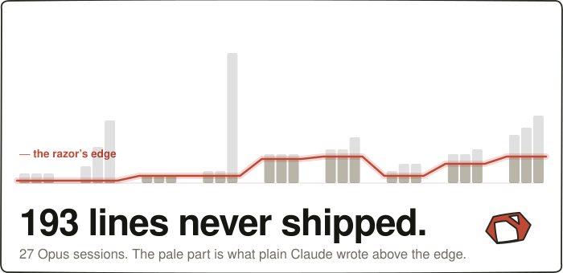

<div align="center">
  
  
  <h1>Razor</h1>
  <p><strong>Before adding code, ask whether the project already has what it needs.</strong></p>
</div>

<p align="center"><strong>Available on</strong></p>
<table align="center">
  <tr>
    <td align="center"><a href="#install"><br />Claude Code</a></td>
    <td align="center"><a href="docs/knowledge/install.md#codex"><br />Codex</a></td>
    <td align="center"><a href="docs/knowledge/install.md#antigravity"><br />Antigravity</a></td>
  </tr>
</table>

<p align="center"><a href="#install"><strong>Install</strong></a> · <a href="#how-to-use-it">How to use it</a> · <a href="#does-it-work">Does it work?</a> · <a href="#learn-more">Learn more</a></p>

## What does it do?

Razor is an add-on for Claude Code, the AI assistant that writes code for you. It keeps a small change small.

You ask for a small feature. The assistant adds a package and helper files. You get more code to look after.

With Razor, the assistant first asks whether the language or your project already has what it needs. Then it writes only what is missing.

<p align="center"></p>

*Ember is the mascot of the Foundry plugins. The scene is an illustration, not a measurement.*

**You ask:** implement `parseQuery` in `query.js`.

**You get:** 4 lines built on `Object.fromEntries` and `URLSearchParams`, against 18 without Razor. One recorded Claude Code session each, on Claude Opus 5, run date not recorded.

## Install

You need Claude Code 2.1.323 or later. You also need Node.js 22 or later, a free program that runs Razor's helpers, and Git, a free tool that tracks changes to your files.

1. Open Claude Code.
2. Type these two lines, one at a time:

   ```text
   /plugin marketplace add V-Songbird/foundry
   /plugin install razor@foundry
   ```

3. Start a new session.

To check that it worked, run `claude plugin list` in a terminal. The list names `razor`.

Using Codex or Antigravity? Follow the [install guide](docs/knowledge/install.md).

To get a new version, follow [Update](docs/knowledge/install.md#update).

## How to use it

- **Do nothing.** Razor works from the next session.
- **Send `razor off`** to pause it for this session, and `razor on` to bring it back. Not on Antigravity.
- **Type `/razor:unused`** to get a report of packages no file uses. It never changes anything.
- **In Codex, type `$razor:unused`.** Codex reads its instructions for that name, but not for a bare `$unused`.
- **Set `RAZOR_DISABLE=1`** to turn Razor off everywhere.

Most people never change a setting. [Razor settings](docs/knowledge/settings.md) lists all of them.

## Does it work?

On November 17, 2026, Claude Opus 5.5 and Claude Sonnet 5 each did 13 jobs three times. They ran with and without Razor, through the Agent SDK. Razor passed 77 of 78 sessions, against 72 of 78 without it. It wrote fewer lines on both models.

**One Claude Sonnet 5 session failed with Razor: 38 of 39 passed.** **Against a rival plugin, Chisle, the gaps are small.** The two models disagree.

The picture below is from an earlier Claude Opus 5 run, 39 sessions per setup, run date not recorded:

<p align="center"></p>

Codex was measured separately. No Antigravity session has been measured yet. Results vary between runs.

[Razor benchmarks](docs/knowledge/benchmarks.md) has every batch, the method and every place Razor loses.

## Good to know

- **Razor advises; it does not enforce.** These checks are not a security boundary.
- **Your safeguards stay yours.** Checking input, security and error handling remain your job.
- **Files written by shell commands skip the file checks.** This holds on every host.

[Razor limits](docs/knowledge/limits.md) lists every limit in full.

## Learn more

[How Razor works](docs/knowledge/how-it-works.md) · [Install and update](docs/knowledge/install.md) · [Razor settings](docs/knowledge/settings.md) · [Razor limits](docs/knowledge/limits.md) · [Razor benchmarks](docs/knowledge/benchmarks.md)

Release notes are on the [Razor releases page](https://github.com/V-Songbird/razor/releases). Report a bug on [Razor's issue tracker](https://github.com/V-Songbird/razor/issues), a vulnerability as [SECURITY.md](SECURITY.md) says. To change Razor, read [CONTRIBUTING.md](CONTRIBUTING.md). [Foundry](https://github.com/V-Songbird/foundry) lists the whole family.

## License

MIT, see [LICENSE](LICENSE).
