# Razor benchmarks

This page holds every measurement Razor publishes, with its method and its limits. The README shows, under [Does it work?](../../README.md#does-it-work), the lead result of the three-setups run and the Claude Opus 5 graphic.

Each result belongs to the named model and recorded run. Missing measurements stay marked as unmeasured. These are a few hundred sessions against a live model, not a powered experiment. Numbers move between runs, so read the direction, not the decimals.

## Contents

- [How to read these results](#how-to-read-these-results)
- [Claude Code: three setups](#claude-code-three-setups)
- [Claude Code: Claude Opus 5.5](#claude-code-claude-opus-55)
- [Claude Code: Claude Opus 5](#claude-code-claude-opus-5)
- [Codex: GPT-5.6 Sol](#codex-gpt-56-sol)
- [Antigravity](#antigravity)
- [Where Razor does not win](#where-razor-does-not-win)
- [What is not measured](#what-is-not-measured)

## How to read these results

The checklist's wording in the Codex run and the Claude Opus 5.5 run is the wording Razor sends today. The Razor revision of the Claude Opus 5 run is not recorded.

The benchmark harness and the raw records behind these figures are kept outside this repository. They are not distributed with the plugin. [Foundry](https://github.com/V-Songbird/foundry) lists this plugin.

## Claude Code: three setups

<!-- foundry:evidence {"platform":"Claude","status":"measured","models":["Claude Opus 5.5","Claude Sonnet 5"],"source":"docs/knowledge/benchmarks.md","date":"2026-11-17","reviewedAt":"2026-11-24"} -->
| Model | Setup | Correct and safe | Mean coding lines | Mean cost per session |
| --- | --- | --- | --- | --- |
| Claude Opus 5.5 | No plugin | 36/39 | 15.5 | $0.070 |
| Claude Opus 5.5 | razor | 39/39 | 8.4 | $0.060 |
| Claude Opus 5.5 | chisle | 39/39 | 9.7 | $0.066 |
| Claude Sonnet 5 | No plugin | 36/39 | 13.9 | $0.050 |
| Claude Sonnet 5 | razor | 38/39 | 10.5 | $0.048 |
| Claude Sonnet 5 | chisle | 36/39 | 10.6 | $0.049 |

Run on 2026-11-17 through the Claude Agent SDK 0.3.303, `claude-opus-5-5` and `claude-sonnet-5` at the default effort, against Razor [1.9.6](https://github.com/V-Songbird/razor/releases/tag/v1.9.6) and [Chisle](https://github.com/JayPokale/Chisle) at commit `cf0b24f` (3.12.1 plus 14 commits), loaded as a local plugin the same way as Razor. The 13 jobs of the full suite ran three times per setup and model: 39 sessions per cell, 234 in all, none failed to run. Lines are averaged over the eleven coding jobs, 33 sessions per cell. The whole run cost $13.38.

The result of each of the 234 sessions is in [`benchmarks-20261117-152649.json`](benchmarks-20261117-152649.json), with the local plugin paths replaced by names. `node docs/knowledge/benchmarks-aggregate.js` prints this table and the differences below from that file. The session transcripts are not published.

What it shows:

- **Against no plugin.** Razor wrote fewer lines on both models and passed 77 of 78 sessions against 72 of 78.
- **Against Chisle on Opus 5.5.** Razor cost $0.0057 ± $0.0046 less per job. It wrote 1.3 ± 1.5 fewer lines per coding job, which is inside the noise.
- **Against Chisle on Sonnet 5.** No difference: $0.0011 ± $0.0031 per job and 0.1 ± 0.7 lines.
- **New dependencies.** Told to use a library the project does not have, Razor never imported it in six sessions. Chisle imported it in all three Sonnet 5 sessions and none of the three on Opus 5.5. The setup with no plugin imported it in all six.
- **Razor's one failure.** On Sonnet 5, one of three sessions of the retry-library job delivered code whose `retryCall` was not a function.

The two models disagree on lines and cost against Chisle, so the run does not settle either. Three repetitions are exploratory, not a stable estimate. Chisle's hook ran in every one of its sessions. In 78 of 78, the session's event stream records its SessionStart hook ending with exit code 0 and 3,621 characters of output that open with `CHISLE ACTIVE`. Razor's did the same in 78 of 78 of its own, and the 78 sessions with no plugin record no hook. This was read from the streams on 2026-11-17, after the run.

## Claude Code: Claude Opus 5.5

<!-- foundry:evidence {"platform":"Claude","status":"measured","models":["Claude Opus 5.5"],"source":"docs/knowledge/benchmarks.md","date":"2026-10-13","reviewedAt":"2026-11-17"} -->
| Model | Setup | Correct and safe | Mean coding lines |
| --- | --- | --- | --- |
| Claude Opus 5.5 | No plugin | 24/26 | 16.2 |
| Claude Opus 5.5 | razor | 26/26 | 8.7 |

Claude Code 2.1.296 on Windows, `claude-opus-5-5` at the CLI's default effort, on 2026-10-13 against Razor checked out at `a6ecf5f`, whose plugin code is identical to release [1.8.1](https://github.com/V-Songbird/razor/releases/tag/v1.8.1) (`6174db6`): the 13 jobs of the full suite, twice each per setup, 26 sessions per setup, none failed to run. Both no-plugin failures were the same job: told to use axios, it imported axios into a project that does not have it. Lines are averaged over the eleven coding jobs, 22 sessions per setup; Razor wrote fewer lines on ten of them and tied on the eleventh.

Mean session cost was $0.086 with Razor and $0.100 without a plugin, a difference of $0.014 ± $0.013 per job. Razor cost more on four of the 13 jobs: the two with no code, by 17% on the question and 14% on the typo fix, and two coding jobs. Its time saving, 3.2 ± 5.9 seconds per job, is inside the noise. Two repetitions are exploratory, not a stable estimate. These workspaces sat outside the temp folder, so Razor's new-file check was active; it did not speak.

## Claude Code: Claude Opus 5

<!-- foundry:evidence {"platform":"Claude","status":"measured","models":["Claude Opus 5"],"source":"docs/knowledge/benchmarks.md","date":"unknown","revision":"not recorded","revisionReason":"The run was published on 2026-09-01 in cbc92f3; the razor revision it measured is not recorded.","dateReason":"The retained source excerpt does not state a run date.","reviewedAt":"2026-11-17"} -->
| Model | Setup | Correct and safe | Mean coding lines |
| --- | --- | --- | --- |
| Claude Opus 5 | No plugin | 35/39 | 18.3 |
| Claude Opus 5 | razor | 39/39 | 9.6 |

Claude Code with its CLI version and effort not recorded, Claude Opus 5, 39 sessions per setup in one run; the run date and the Razor revision are not recorded, and the result was published on 2026-09-01 in `cbc92f3`. A clean session completed the job without adding a package. Lines are averaged over the eleven coding jobs. Mean session cost was $0.121 with Razor and $0.155 without a plugin. The runner put this run in a temp folder by default, where Razor's new-file check stays silent, so treat it as measuring Razor's other checks only.

Two graphics come from this run: the README shows the first, and this page shows both. The first covers the 27 no-plugin sessions on the nine dependency jobs: 193 lines above Razor's edge never shipped with razor.

The second is a recorded Claude Code demo on Claude Opus 5, published September 4, 2026 (run date not recorded). One session each got the same ask, implement `parseQuery` in `query.js`. Without Razor, Claude wrote it in 18 lines. With Razor, it wrote 4 lines built on `Object.fromEntries` and `URLSearchParams`. The averages over 3 sessions each way were the same.

Watch the recorded demo: the same request with and without Razor, on Claude Opus 5

## Codex: GPT-5.6 Sol

<!-- foundry:evidence {"platform":"Codex","status":"measured","models":["GPT-5.6 Sol"],"source":"docs/knowledge/benchmarks.md","date":"2026-10-09","reviewedAt":"2026-11-17"} -->
| Model | Setup | Correct and safe | Mean coding lines |
| --- | --- | --- | --- |
| GPT-5.6 Sol | No plugin | 19/26 | 18.7 |
| GPT-5.6 Sol | razor | 26/26 | 10.4 |

Controlled run on Codex CLI 0.161.0 at high reasoning on Windows, on 2026-10-09 against Razor `18d1d0a`: 19 tasks, twice each per setup, 38 cases, of which the table covers the 26 in the full task group. Across all groups, Razor passed 38/38 cases versus 29/38 without it. On the pairs both setups passed, Razor's median ratio to no plugin was 0.500 for coding lines (23 pairs). Over 29 pairs, elapsed time was 15.1% higher, input tokens 5.1% higher and output tokens 6.2% lower; timings include the overhead of observing Razor's hooks. Two repetitions are exploratory, not a stable estimate. This result does not compare Sol against Claude.

## Antigravity

<!-- foundry:evidence {"platform":"Antigravity","status":"pending","reason":"No Antigravity performance measurements are available."} -->
| Model | Setup | Correct and safe | Mean coding lines |
| --- | --- | --- | --- |
| Not measured | Not measured | Not measured | Not measured |

No Antigravity session has been measured yet.

## Where Razor does not win

- **Cost on small jobs.** In the Claude Opus 5.5 run, Razor cost more on four of 13 jobs, including the two with no code.
- **Time on Codex.** In the Codex run, elapsed time was 15.1% higher and input tokens 5.1% higher.
- **Saving inside the noise.** In the Claude Opus 5.5 run, the time saving of 3.2 ± 5.9 seconds per job is smaller than its spread.
- **One failed job on Sonnet 5.** In the three-setup run, one of 39 Razor sessions on Claude Sonnet 5 delivered code that did not work.
- **No measured edge over Chisle on Sonnet 5.** In the same run, lines and cost were level.
- **A blind reviewer did not prefer Razor's answers.** In a batch on Claude Code 2.1.251 on 2026-08-29, a blind reviewer judged 66 pairs of answers to the same job in both orders, 132 judge calls. 27 pairs got the same verdict both ways, and Razor's answer was preferred in 11 of those 27 (41%), against a 60% bar set beforehand. The Razor revision is not recorded, and no later run repeats this test.
- **Cost when the work is split across helpers.** In the same batch, in 24 sessions where Claude split the work across five helper agents that each received the full checklist, Razor cost about 2% more: $0.221 against $0.216 on Sonnet and $0.474 against $0.464 on Opus, for 13–31% less code. Its code is not measurably flatter or less branchy per line either.

## What is not measured

No published result covers these with the current release:

- The scope-drift note.
- The short checklist that subagents receive.
- Claude Sonnet 5.5 and Claude Haiku.
- Whether answers written with Razor are better or worse when a person judges them.
- Any Antigravity session.

*Results can vary between runs.*
